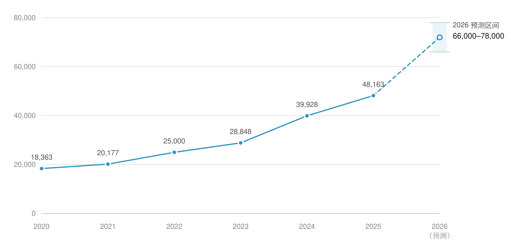
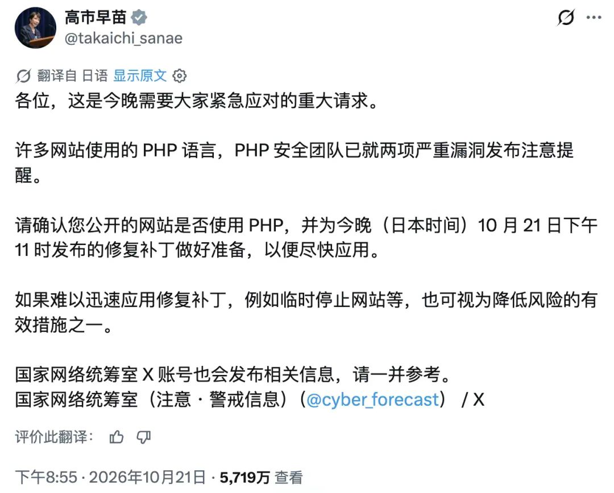

# 补丁之外：AI 时代怎么守？我亲历的四次安全事件早就给出了答案

2018 年的一个晚上，一名实习生把一台 Redis 暴露在了公网，攻击者提权后开始挖矿。我接手处理后，第一反应是清理进程、换机器——但真正让我不安的不是这台机器，而是开发环境的资产和生产环境共享了可路由的网络空间。今天是一个 Redis，明天可能是任何一个「临时开一下」的服务。全面重新部署只是止血；后来容器化集群时，我用不同的 VPC 把开发、测试、生产彻底隔开，让「环境之间默认不可达」成为架构约束，而不是靠人记得改配置。

这件事之后我越来越不想反复处理同一类问题。当错误总能绕过人的纪律时，解法不在响应端，而应该在约束端。

从 2017 到 2020，我处理了四次这样的事。它们没有一次源于某个 CVE，却分别对应内容滥用、配置暴露、资源盗用和凭据泄露——恰好是「补丁管不到」的区域。而 2026 年 10 月的这一天，当 PHP、Node.js、Go 的补丁扎堆发布，加上 GitLab 爆出 10.0 分漏洞、多个基础设施停摆时，我意识到：漏洞总量在陡增，利用窗口被压成负数，而防守方真正能依靠的，往往不是打补丁的速度，而是暴露面本身是否还存在。毕竟，正如一位网友在总结这疯狂一天时所说：「总之，今天是星期三。」

## 「疯狂星期三」完整时间线（2026-10-20 至 10-22）

在展开之前，先把 2026 年 10 月那次「疯狂星期三」的账本放上来。从 10 月 20 日到 22 日凌晨，两天内爆出的不止 PHP——按首次通告时间排列：

| 日期 | 项目 | 事件 | 严重性 | 首次通告（北京时间） |
|---|---|---|---|---|
| 10/20 | eMudhra | 8 张中间证书的私钥可被恢复，可伪造任意网站证书 | 严重，无 CVE | 10/20 |
| 10/20 | Plex | Plex2Shell，四个 CVE 串成未认证 RCE | 单 CVE 4.3–7.2，整链 9.8（研究者自评） | 10/20；KEV 同日收录 |
| 10/20 | Chrome | Chrome 156，353 个安全修复，6 个严重 | 最高严重 | 10/20 |
| 10/21 | PHP | PHP2Shell，两个引擎级漏洞 | 9.2 | 10/21；22:00 发布 |
| 10/21 | Java | Oracle 10 月 CPU，Java SE 55 个修复 | 最高 7.5 | 10/21 |
| 10/21 | GitLab | CVE-2026-110264 等 12 个问题，未认证 RCE | 10.0 | 10/21 |
| 10/21 | Go | CVE-2026-111943，crypto/x509 拉黑不可信中间证书 | 未评分 | 10/19 修复；10/21 08:52 公开 CVE |
| 10/21 | Node.js | 三个分支的安全版本，10 个 CVE | 严重，无 CVE | 10/21 18:38 |
| 10/21 | LiteLLM | 1.107.0 在 PyPI 与 Docker Hub 投毒 | 严重，无 CVE | 10/21 |
| 10/21 | Python | 3.15.1/3.14.9/3.13.17，eMudhra | 未评级 | 10/21 |
| 10/22 凌晨 | Cisco | 14 份公告，34 个 CVE | 最高 9.8 | 10/22 |
| 10/22 凌晨 | Railway | 环境变量泄露，部分明文被读取 | 严重，无 CVE | 10/22 04:44（官方博客） |

（说明：CVSS 10.0 与 9.2 为官方公告给出的分数；Cisco 整批最高 9.8；LiteLLM 与 Railway 没有 CVE，也没有评分。）

## 一、一线经验：四个没有 CVE 的安全事件

这张表上没有的，才是我真正想讲的。下面四件事发生在 2017 到 2020 年间，没有一件出现在任何 CVE 通报里，却一步步改变了我对「安全」的理解——从响应事件，转向消灭事件类别。

**2017 年：直播间被发送不良信息 → 内容风控系统**

有人在讲课直播间发送不良信息。攻击者没有利用任何代码缺陷，只是把公开交互功能当成了广播渠道。停业整顿是止血。风控不能是附属品，必须独立于业务逻辑存在。于是我们自研了内容风控系统，从「事后发现」转向「实时拦截」。这是我第一次意识到，任何允许用户输入并公开传播的功能，都需要一个独立的滥用检测层作为准入条件。

**2018 年：实习生暴露 Redis 公网被提权挖矿 → 全面重新部署 + 开发/生产 VPC 彻底隔离**

一名实习生把一台 Redis 暴露到了公网。但我清楚他不过是触发者——Redis 默认无认证，暴露公网等于把管理权限直接交给扫描器，换任何一个新人，同样的错误只是早晚问题。攻击者提权挖矿说明入侵已触及主机层——被提权的主机不能信任，清理恶意进程不等于清除后门，全面重新部署更换机器是唯一能保证干净的选择。

我当时的判断是：这表面是一次配置失误，根子是网络边界的结构性缺失——只换机器救不了下一台。但更深一层的问题是：开发环境的 Redis 和生产环境的网络边界没有彻底分开。某个环境里一个未改的默认配置，就足以成为生产级暴露面。后续容器化集群时，我用不同的 VPC 把开发、测试、生产彻底分隔，让「环境之间默认不可达」成为架构约束；Redis 也从此不再由人手动开——申请后自动在集群上拉起，访问必须走 VPN。错误仍然可能发生，但隔离让错误的爆炸半径被架构限制住。这也成了我后来转向云原生架构规范化的直接动因之一。

**2019 年：视频存储被盗链薅羊毛 → 异常流量监测 + 防盗链**

视频存储被别人利用上传，并用于他们的网站播放，消耗我们的带宽和容量。内容不违规、播放发生在站外，审核无法定性。我当时的判断是：这不是内容问题，是资源滥用问题，必须用独立于内容审核的技术手段来解决。于是我做了异常流量监测、容量监测和防盗链处理。资源类风险需要有自己的基线、告警和自动阻断阈值，防盗链是访问控制，异常监测是检测，两者配合才能既止损又不误伤正常用户。

**2020 年：实习生上传生产 Key 到 GitHub → 换 Key + 细粒度权限 + 配置中心 + 云原生**

实习生把云服务生产 Key 上传到了 GitHub。换 Key 是止血，但我清楚实习生只是触发者，根因是凭据没有独立于代码的存在方式。于是我们切分了更细粒度的权限，缩小单点泄露的爆炸半径；我开发了配置中心，清理了代码里硬编码或配置文件进仓库的情况；并全面迁移完成了容器化云原生。凭据泄露的解法不是「教人不要上传」，而是让凭据根本不在代码里。

**四次之后**

从 2017 到 2020 年，处理方式有一条清晰的下沉路径：业务层风控 → 基础设施层暴露面 → 资源层监测 → 工程流程层凭据管理。从「响应事件」逐步转向「消灭事件类别」。

| 时间 | 事件 | 类别 | 止血 | 治本 |
|---|---|---|---|---|
| 2017 | 直播间被发送不良信息 | 内容滥用 | 停业整顿 | 自研内容风控，实时拦截 |
| 2018 | Redis 暴露公网被提权挖矿 | 配置暴露 | 全面重新部署 | VPC 彻底隔离 + 申请自动拉起 + VPN 访问 |
| 2019 | 视频存储被盗链薅羊毛 | 资源盗用 | 异常监测 + 防盗链 | 独立基线、告警、自动阻断 |
| 2020 | 生产 Key 被上传到 GitHub | 凭据泄露 | 换 Key | 配置中心 + 细粒度权限 + 云原生 |

这四次之后我不再相信「让人小心一点」能解决问题。能约束住错误的，是架构。

## 二、总量曲线：从平缓到垂直

这四件事都在补丁之外——没有 CVE，也就没有补丁可打。但近年的数据说明，连「补丁之内」的领域也在失守。先看总量：

2018 到 2021 年，全球 CVE 年发布量基本在 1.8 万到 2.1 万之间波动。真正的转折发生在 2021 年之后：

从 2020 到 2025 年，总量增长了 163%，六年约 4.3 倍。2026 年的月度数据更能说明陡度：1 月披露 5,045 个，7 月翻倍到 10,477 个，8 月进一步升至 10,740 个。FIRST 年初预测全年约 66,000 个，但前 7 个月就已超过 45,000，实际节奏超过了预测。

不过，总量曲线会误导人。新增的绝大部分并不是紧急漏洞。Red Hat 2025 年评估了 5,478 个 CVE，其中 Critical 只有 3 个，且是连续第二年下降；被确认在野利用的仅 9 个，占 0.16%。前一年增加的 1,206 个 CVE 中，84% 是 Moderate/Low 级别。Linux 内核 CNA 的大规模签发等机制性因素，也在人为推高基数。

真正值得关注的是高严重性漏洞：2020 年约 7,148 个，2025 年升至约 15,888 个，翻了一倍以上。总量有水分，这条「可被实际利用」的供给曲线没有。

这条曲线的形状，还对应着三个时间点。2023 年起的抬头，与 ChatGPT 的出现重合；2024 年的 +38.4%，与智能体编码的大规模落地重合；2026 年的再加速，则对应智能体工具能力的进一步成熟——从「人拿着 AI 写代码」，走向「AI 自主跑流水线」。这不是说 AI 造成了漏洞增加——更像体检：以前很少有人去医院做检查，现在检查普及了，癌症检出率自然上升。AI 把一直存在的「已知的未知」翻了出来：漏洞被发现的速度，第一次超过了人类消化它们的速度。这一点在第四节还会展开。

## 三、真正陡峭的曲线：从披露到利用，被压成了负数

如果只看数量，会错过近三年最根本的变化。

2020 年，CVE 披露到首次利用的中位时间约为 30 天；到 2025 年，这个窗口已压缩到 5 天以内，28% 的漏洞在披露当天或补丁发布之前就已被利用——对于这部分漏洞，利用时间是负一天，因为修复根本还不存在。2026 年的数据进一步显示，利用时间已缩短至 24 小时，而 2025 年这个数字还是 72 小时。Mandiant M-Trends 2026 报告甚至给出了更极端的结论：平均利用时间已经变成负七天。这次 PHP 的两个 9.2 分漏洞就是活例：AWS 蜜罐记录到攻击者 10 月 17 日就开始尝试利用，比公开披露早了 4 天；10 月 21 日 22:00（北京时间）补丁发布，watchTowr 在 19 分钟后就观测到了在野利用。

防守方的修复节奏几乎没有同步变化。组织平均需要 88 天才能修复一个已有关键补丁的 Critical 漏洞，50% 的 CISA KEV 条目在补丁发布 55 天后仍未修补。攻击者在小时级行动，防守方在月级响应。这条「时间差曲线」，才是近年漏洞态势最陡峭的部分。

## 四、AI 的双重角色：发现引擎与攻击加速器

AI 在这条曲线上扮演的角色，不是「制造了所有漏洞」，而是把发现速度推到了人类流程无法消化的水平。

Mozilla 借助 Anthropic 的专用智能体，在一个季度内将 Firefox 的漏洞披露量推高了 164%，单次发布修复了 271 个历史遗留 bug。AI 在做的是把「已知的未知」变成「已知的已知」。AI 辅助发现的漏洞中，50% 通向 RCE，而传统方式发现的漏洞中这一比例是 26%；AI 发现的漏洞里 Low Risk 占比更低，Medium 和 High 占比更高。

更近的例子就是这次 PHP 的两个 9.2 分漏洞本身：Calif 的研究员 Ryan A 用 GPT-5.6 Sol 找到了利用路径，又用 OpenAI 一款尚未发布的模型做出了完整利用，OpenAI 官方确认了这件事。两个多月后，这条路径变成了全球范围内的 PHP2Shell。

同样发生在发布流程里的，还有 PostgreSQL 19 的推迟。原定 10 月底发布的 PG19，被推到 11 月 19 日，还临时加了一个 RC2。原因有两层：Beta 阶段约 8–10 个重要特性被撤回（正常周期通常只撤 1 个），部分是架构级缺陷；更直接的是，迅速成熟的大模型代码审查和模糊测试，把过去可能五年才能逐渐浮现的边缘缺陷，在几天里集中扫了出来——开发者突然面对约 40 份缺陷报告，而处理每一份（复现、判定、修复、测试）都有固定开销，人类时间很快耗尽。核心提交者 Peter Eisentraut 称之为「有效质量门槛被抬高」：代码写就时还没有这么强的审查工具，到发布时，新工具已经能发现过去发现不了的问题。

不过要补一个注脚：committer Tomas Vondra 逐一核对邮件线程后指出，12 个被撤特性里只有 4 个是 AI 辅助审查发现的，另外 8 个出自资深人类审查者；AI 对延期的主要影响，是 2026 年 PostgreSQL 的 CVE 通报从往年约 5 个飙到 44 个，安全雪崩消耗了审查者的时间。「AI 发现的 bug 多到修不完」只说对了一半：12 个撤回里，AI 只找到 4 个。AI 真正的影响是警报雪崩——体检仪器不制造癌症，但它能把门诊挤爆。

与此同时，AI 本身正在成为一个高严重性的新漏洞来源。2026 年 Q2，AI 与 LLM 服务的记录漏洞数量较 2025 年底增长了 10 倍，达到 935 个，其中严重漏洞 119 个。更关键的是漏洞的位置：智能体编排中间件占了 AI 相关漏洞的 50%，2026 年披露量增长了 347%。风险重心不在模型本身，而在连接模型与真实系统的「胶水层」——认证、权限、工具调用接口。

## 五、AI 生成代码与供应链：攻击面在系统性扩大

当 AI 开始写代码，引入依赖的「胃口」远超人类。Black Duck 2026 年的审计显示，平均每个代码库的漏洞数量跳增了 107%，开源组件数量增长 30%。约 20% 的 AI 生成代码样本会引用根本不存在的包名，这直接催生了「slopsquatting」攻击——攻击者抢注这些幻觉包名来投毒。

供应链攻击也随之升级。今年第二次被劫持的 LiteLLM，在每一个 wheel 包和 Docker 镜像（包括 latest）中都塞进了凭证窃取器和远程访问木马——你甚至不需要在代码里导入它，只要单纯执行安装就足以中招。更危险的信号是，攻击者利用的是合法的 CI/CD 发布流程本身——部分恶意包甚至带有合规的 SLSA Build Level 3 验证。供应链的「信任机制」没有失灵，而是被合法流程「利用」了。

## 六、两个非 CVE 事件：ARTEX 与 TiDB 暴露的架构风险

补丁可以修代码，但修不了攻击者的速度和云架构的假设。

ARTEX 是一个 AI 驱动的渗透测试代理。CrowdStrike 确认，攻击者利用它在 9 月底至 10 月初入侵了韩国多家金融机构。更具讽刺意味的是，ARTEX 并非黑产工具，而是 2026 年 8 月百度「agent+」攻防挑战赛的冠军作品。从夺冠到被用于击穿韩国银行，只隔了大约一个月。它被武器化的方式不是代码被改写，而是使用场景被切换：同一套架构，换目标、关掉授权校验，就从安全测试工具变成了入侵流水线。而且攻击者利用的往往不是核心系统，而是面向外部贷款招募人员的辅助查询功能这类「看起来不重要」的暴露面。

另一件事是 PingCAP（TiDB 背后的公司）内部系统被入侵。黑客组织声称窃取了约 10.6TB 数据，涉及 18 万条租户记录、超过 11 万个 API Key。PingCAP 确认攻击者利用被盗的服务账号凭据访问了部分内部系统。真正值得警惕的架构信号是：云服务商可能在双方都不完全知情的情况下存储了客户的敏感数据。攻击路径指向代码仓库中的 GCP 服务账号密钥和 Azure 凭据，据称每六小时导出一次，累计 88 次未被检测。云控制平面的凭据一旦落入攻击者之手，持续的数据外泄可以在较长时间内不被发现。

## 七、先打补丁：本次更新的 CVE 清单与修复动作

回到可执行层面。ARTEX 与 TiDB 说明攻击者不缺速度和路径，但「代码缺陷」这一半，补丁仍然管得住。全貌在前面那张时间线表里，这里把三个运行时拆开讲。

**PHP（PHP2Shell）：两个 9.2 分 RCE，补丁窗口最窄**

影响范围极广，从 PHP 5 起的几乎所有版本都可能受影响。Apache mod_php 风险最高，攻击可在任何应用代码执行前触发，无需认证。

| CVE 编号 | 漏洞类型 | CVSS v4.0 | 核心成因 |
|---|---|---|---|
| CVE-2026-109618 | 远程代码执行 (RCE) | 9.2 | 内存耗尽时请求内存未完整初始化 |
| CVE-2026-109619 | 远程代码执行 (RCE) | 9.2 | 请求结束后全局状态指向已释放内存 |

修复版本：8.5.12、8.4.27、8.3.36、8.2.35。

**现实参照：全球规模的「下线潮」。** 这次漏洞的紧迫性有一个史无前例的公开注脚。FBI、CISA、英国及 CERT-EU 等机构均公开建议「把系统下线」。日本首相高市早苗在早上 5:55 通过 X 呼吁 4880 万国民尽快修复，并明确将「暂时关闭网站」列为有效手段；当晚，其个人官网即被主动下线，次日修复后才恢复。

随后，荷兰议会、鹿特丹港、维基百科、Archive.org 等纷纷采取了断网措施。当一个 9.2 分的 RCE 已有公开 PoC 流传时，「先切断可达性、再修复」不再是极端选项，而是暴露面管理的标准动作。

**Node.js：Brotli RCE 是核心，但利用有前提条件**

本次共修复 10 个漏洞。CVE-2026-111497 的 RCE 需要应用实际调用 Brotli 解压，并非默认触发。此外还修复了 TLS 证书主机名校验绕过等 3 个高危漏洞。

修复版本：22.23.4（LTS）、24.22.1（LTS）、26.12.1（Current）。升级后需重启 Node.js 进程，容器需更新镜像。

**Go：没有传统 CVE，但「不重新编译等于没修」**

Go 本次修复的是 CVE-2026-111943，涉及 8 个私钥已泄露的中间 CA 证书（匹配到了 eMudhra 旗下的机构）。核心操作点：拒绝列表硬编码在工具链中，升级工具链后，必须对所有 Go 应用重新编译并重新部署，拦截机制才会生效。

这里有一个让人啼笑皆非的细节：作为签发超 6000 万证书的机构，eMudhra 本该使用超过一百位长度的随机数作为私钥，但安全人员发现，其中一个私钥竟然只是数字「4」，其他的则是「66」和「237」之类的极短数字。当底层信任链脆弱到这种地步时，Go 团队直接在编译器级别硬编码封杀，是唯一理性的选择。

| 优先级 | 对象 | 核心动作 |
|---|---|---|
| P0（立即） | PHP | 升级补丁；无法升级的，按临时措施收敛，或临时下线 |
| P0（立即） | TiDB Cloud 凭据 | 审计、轮换、收敛服务账号与 API Key 权限 |
| P1（紧随） | Node.js | 升级并重启进程/镜像 |
| P1（紧随） | Go | 升级工具链，必须重新编译并部署所有 Go 二进制 |
| P2（排期） | ARTEX 类暴露面 | 收敛互联网可见的辅助系统；建立资产清单与枚举告警 |

## 八、但只打补丁不够：从「修复驱动」转向「机会驱动」

上面的清单解决的是「已知的代码缺陷」，前面四个一线案例解决的是「补丁覆盖不到的风险类别」。但 Mandiant M-Trends 2026 报告显示，平均利用时间已经变成负七天。在这个前提下，补丁只是整套动作中的一环，防守逻辑需要分三层升级。

**第一层：漏洞管理从「修复驱动」转向「机会驱动」**

用风险四要素替代 CVSS 排优先级：CISA 废弃了按 CVSS 分数一刀切的策略，改用四变量风险模型（公网暴露、KEV 目录、可自动化利用、技术影响）。命中全部条件的漏洞，修复窗口是 3 天。

把检测能力前置到「补丁可用之前」：当利用时间倒挂时，等待补丁发布再行动，等于把防守窗口拱手让出。解法是把检测和响应能力对准「漏洞被利用之后攻击者会做什么」：凭据滥用、异常进程链、横向移动。

当修复成本高于重构成本时，直接淘汰旧组件：在这次 PHP 漏洞爆发当天，我的一位朋友醒来看到新闻，没有去找补丁，而是直接用 AI 工具把他的 WordPress 博客重构到了别的技术栈。公开博客一旦被 RCE 利用，攻击者根本不需要提权，只需植入一段 JS，就能让访客浏览器变成挖矿肉鸡。过去重写成本太高，只能硬着头皮打补丁；现在 AI 把代码重构的门槛降到了小时级。当修补老旧技术栈的成本超过了用 AI 重构的成本时，「直接淘汰它」就是最彻底的暴露面收敛。

除了淘汰，还有另一条路：软件停更了，但有人接手把补丁续上，或者干脆用更安全的语言重写。MinIO 在 2025 年 10 月停止常规社区版后，有人接过来做了 Silo 维护分支，半年修了 20 多个安全漏洞；也有人用 Rust 从零重写了 RustFS，2026 年 9 月 GA，S3 兼容、支持原地替换二进制。反过来，那些停更、还连在公网上的老服务，才是这场危机里最危险的一批：RCE 爆出来没有补丁可打，只能排队等死。不要把「现有二进制不会自己坏」当作安全——软件不死，只是没人修了。

**第二层：供应链和 AI 生成代码，把门禁做在构建环节**

把 SBOM + SLSA L2+ + Sigstore 签名作为最低门槛：构建溯源达到 SLSA Level 2 以上，容器镜像用 Sigstore 无密钥签名并验证。

对 AI 推荐的依赖强制走「注册表核验 + 锁文件固定」：禁止 AI 代理在无人审查或无允许列表的情况下自主安装包。对 HIGH 及以上级别的依赖漏洞，CI 应直接阻断合并。

分支保护规则对 AI 生成的 PR 不能放松：审查重点从「代码是否可读」转向「是否引入了新依赖、是否触碰敏感数据路径」。

**第三层：云凭据和暴露面，消除「匿名通行证」**

静态密钥就不应该存在。工作负载用实例角色，CI/CD 走 OIDC 联邦拿短期凭据。

对存量静态凭据做「先禁用、再替换」的收敛：先禁用观察报错，然后发放独立凭据，收窄权限到最小。

当系统无法修复时，网络隔离是最后的底线：防守手段存在一个「降级阶梯」。正常情况下，我们打补丁；如果来不及打，用 AI 工具把老旧系统重构；但我还见过一种更极端的系统：没有源码，没有文档，只有一个编译好的二进制执行文件。当底层爆出 RCE 时，你无法重新编译，无法分析调用链。对这类「黑盒系统」，唯一能做的，就是用 VPC、零信任网关把它彻底「包裹」起来，切断所有不必要的入站流量。既然内部的错误无法立刻消除，那就用外部的网络边界，把错误的爆炸半径压到零。

## 九、结论：补丁要打，但节奏要变

回到那个补丁扎堆的星期三。我朋友一早用 AI 重写博客的操作，比任何复杂的应急预案都更能说明问题。面对两个 9.2 分的 RCE，连日本首相官网都选择了主动下线，一个普通开发者用 AI 重构了系统，而那些只剩下二进制文件的黑盒服务，则只能被硬生生锁进 VPC 的最深处。

我亲历的四个事件已经说明，内容风控、暴露面收敛、资源监测、凭据管理这四类控制，分别对应业务滥用、配置错误、资源滥用和凭据泄露——没有一个能靠单纯打补丁解决。而近年的漏洞增长曲线，实质是三条线的剪刀差：总量曲线在 AI 推动下变陡，发现—利用时间曲线被压成负数，而防守端的修复曲线几乎是一条水平线。

说到底，四次事件给的是同一条经验：真正划算的安全投入，是把错误的发生条件从架构上删掉，而不是把响应练得更快。内容风控、VPC 隔离、基线告警、凭据出代码，做的都是同一件事——把一类事件从「以后还会发生」变成「根本不会发生」。响应能力决定下限，架构约束决定上限：修复速度追不上攻击速度的时候，唯一能赢的方式，是不给攻击留入口。

对 AI 的态度，值得单独说一句。它不是漏洞暴涨的元凶，也不是天然的安全救兵——它是杠杆，同时放大发现和修复两端：攻击者用它把扫描和武器化提速，防守方用它把审查和重构提速。PG 19 的例子说明，AI 审查会在发布前把质量门槛抬高；ARTEX 的例子说明，同一个智能体换个目标就是入侵流水线。所以结论不是「拥抱」或「警惕」二选一：用 AI 的前提是把门禁做进流程——依赖要核验、产物要签名、改动要审查。杠杆两端都变长的时候，胜负取决于谁动作更快。

如果只能做三件事：

1. 对公网暴露、KEV、可自动化利用的高危漏洞，压到 3 天闭环；来不及打补丁的，用 AI 重构淘汰老旧组件，连源码都没有的，用零信任和 VPC 彻底隔离。
2. 让静态云凭据从代码和配置中消失，换成短期身份。
3. 把供应链与 AI 生成代码的门禁前移到构建环节——锁文件核验、签名验证、依赖漏洞阻断合并（详见第八节第二层）。

补丁仍然要打，但补丁的定位从「唯一的修复手段」降为「整套暴露面收敛动作中的一环」——因为当利用可以发生在补丁之前时，真正决定生存的已经不是修复速度，而是在攻击者利用之前，暴露面本身是否还存在。毕竟，正如那个总结这疯狂一天的推文所说：「总之，今天是星期三。」而下个星期三，你永远不知道会爆出什么新漏洞——到那时候，决定你活下来的，不是响应有多快，而是**有没有好的架构和规范，未雨绸缪、防范于未然。响应能力决定下限，架构约束决定上限。**

## 附：主要数据来源

- Red Hat：《2025 Product Security Risk Report》
- Mandiant：M-Trends 2026
- CISA：KEV（Known Exploited Vulnerabilities）目录
- FIRST：2026 年漏洞预测
- Black Duck：2026 年开源安全与风险分析
- Mozilla：Anthropic 智能体协助漏洞披露的官方说明
- CrowdStrike：韩国金融机构入侵事件通报
- PingCAP：安全事件官方声明
- The Register：Postgres 19 delayed after AI reviewers find more bugs than humans can fix
- InfoQ 中文站：AI 审查员把 PostgreSQL 19 拖延期了？committer 拆完 12 个撤回
- PHP Foundation：Today's PHP Security Release（2026-10-21）
- 共同社：高市早苗因 PHP 漏洞一度关闭自身官网

