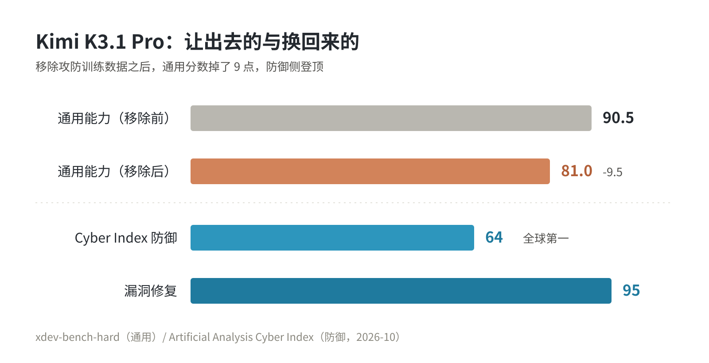
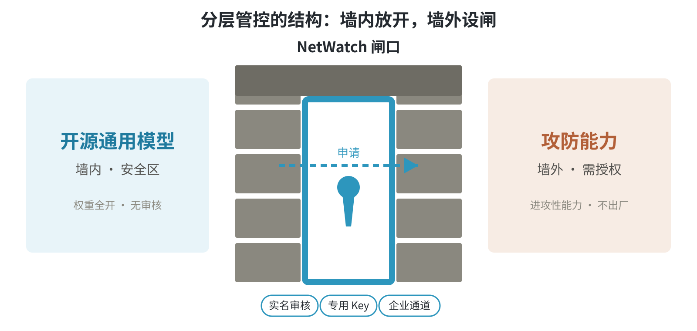

# DeepSeek：Cyber 版在即，国产模型网络安全能力集体收口

上周写完《补丁之外》，讲漏洞和利用窗口，落脚点是「响应能力决定下限，架构约束决定上限」。写完没几天，连着看到三条消息：DeepSeek Cyber 版申请入口现身官网前端代码，Kimi K3.1 Pro 训练阶段移除攻防数据，GLM-5.2 被深信服拿去做了安全基座。

我的第一反应是眼熟。这三件事，本质是模型厂商在给能力收口。

## DeepSeek Cyber 版：申请入口已经写进官网代码

消息目前暂时还没有公告，但已经有人从官网前端代码里扒出来了。

DeepSeek 官网前端出现了一个未上线的申请入口，指向 Cyber 版模型的测试通道。从代码里能拼出的轮廓大致是：

- 分企业版和个人版两条申请通道；
- 实名审核；
- 通过后发放专用 API Key；
- 目前小范围灰度测试。

另一条配套消息更要紧，也已经传出：开源版本后续将**剥离或限制网络安全相关能力**，应对监管。

Cyber 版并非简单给开源模型加一个「安全模式」开关，而是把这部分能力从通用模型里物理切走或削弱。想用？走专用模型、走企业通道、过实名审核。

## Kimi K3.1 Pro：已经这么干了

月之暗面更早。Kimi K3.1 Pro 已经做过一轮「去武器化」：

- 中期训练和 RL 阶段移除了攻防对抗数据；
- 代价很直接：`xdev-bench-hard` 从 90.5% 掉到 81.0%；
- 但换个榜单看，它在 Artificial Analysis Cyber Index 上防御排第一（64%），漏洞修复子项接近 95%。

账不难算：拿 9 个点的通用分数，换防御侧全球第一和接近满分的漏洞修复。模型还是那个模型，喂什么数据、往哪个方向强化，就长出哪方面的能力。方向在训练时拧死，比在输出端做内容过滤干净。

## GLM + 深信服：收回来的能力去哪

能力从通用模型收回来，总得有个去处。智谱和深信服走的就是这条路：

- 深信服的 Sangfor AI 安全基座直接采用 GLM-5.2；
- CyberGym 评测 1507 项挑战解决 1301 项，得分 86.3%，全球前四、国内第一；
- 超过了 OpenAI 和 Anthropic 的对应模型。

拆开看，这条路每一步都是安排过的：通用模型出底座，安全厂商做落地，能力只从企业产品和私有化部署放出去。开源社区拿到的，是一个不带攻防能力的底座。

## 三家公司，同一个方向

把三条消息摆在一起：

| 厂商 | 动作 | 能力去向 |
| --- | --- | --- |
| DeepSeek | Cyber 版灰度，申请入口进官网代码；开源版据传将剥离网安能力 | 专用模型 + 企业/个人双通道实名审核 |
| 月之暗面 | K3.1 Pro 训练阶段移除攻防数据 | 防御能力保留，进攻性能力移除 |
| 智谱 × 深信服 | GLM-5.2 作为 Sangfor AI 基座 | 企业产品 + 私有化部署 |

放在一起，事情就清楚了：国产开源大模型的攻防能力，正被成建制地从通用版本里剥走，往后只从三个口子放出来——专用模型、企业通道、私有化部署。

这就是「分层管控、主动收口」。

## 为什么是现在

直接推手是监管。模型攻防能力是典型的双用途技术：同一个「发现漏洞」的本事，白帽子手里是渗透测试，黑产手里就是武器库。开源模型人人可下载，无审核无记录，监管根本没法分「谁拿它去干什么」。收口以后就不一样了，每次能力释放都绑着身份、用途和审计记录。

收口迟一步的代价，这两天刚演过一遍。10 月 29 日，币安热钱包被攻破，初步估计损失 63 亿美元，约 30 亿被平台和各方联手冻结，剩下的 30 多亿至今没着落——加密史上最大的一单。攻击路径更值得看：智能合约没有漏洞，突破口是一名 DevOps 工程师的笔记本，被拿下后再从服务容器里提交未经授权的提现。代码没问题，人的入口却没守住。币安暂停提现，拿 SAFU 基金兜底，说 48 小时内恢复——全球最大的交易所，一夜之间被一台笔记本打停。

这种案子每出一次，「能力无门槛、入口无分层」的空间就被压缩一分。监管和厂商，看的是同一组数字。

还有一层，安全行业的生意也在变。当 AI 把漏洞发现本身大幅提速（上一篇的 CVE 总量和 19 分钟利用窗口已经摆过），「会找漏洞」就从卖点变成了敏感资产，跟漏洞情报一样要分级管控。模型厂商不是不想给，是不敢再无门槛地给。

## 似曾相识

2018 年那件事（《补丁之外》里写过），一名实习生把一台 Redis 暴露到了公网，攻击者提权后开始挖矿。我接手后没有止于清理这台机器，而是把起实例的权力从人手里收回来：Redis 不再手动开，申请后自动在集群上拉起，访问必须走 VPN。2020 年那次更彻底，散落在各处的密钥收进凭据配置中心，代码里从此不见明文。

当年做这些的时候，我没觉得有多大深意。出了事，把口子扎紧，开发和运维的本能而已。现在回头看，模型厂商这一轮跟我当年是同一个配方：**能力本身没错，错的是无门槛**。问题从来不是「这东西危险不危险」，而是「谁、在什么约束下、拿它干什么」。

区别只是，我收的是公司内部几台服务器的权限，他们收的是所有人的模型。

## 赛博朋克提前上演

玩过《赛博朋克 2077》的人对这个结构不会陌生。旧网（Old Net）崩溃之后，失控 AI 被封在 Blackwall 外，人类退守墙内一小块日常网络。NetWatch 守在墙口，谁要穿越黑墙调用外面失控的智能，得过它的授权。墙内是安全区，墙外是武器级的智能，中间隔着一道要身份的闸。

对到这一轮收口上，一一对应：开源通用模型是墙内，攻防能力是墙外，专用 Key、企业通道、实名审核，就是 NetWatch 的那个闸。

只有一处拧着。游戏里怕的是外面的 AI 杀进来；现实里怕的是墙内的人不经许可出去拿武器。同一道闸，守的方向正好相反。科幻场景没有等 2077，2026 年就上线。

## 对用模型的人是好事还是坏事

那这事对用户是好是坏？看你是谁。

对防守方——企业安全团队、运维、做代码审计的——影响不大，甚至更好。Kimi 的漏洞修复子项接近 95%，深信服方案全球前四，收敛后的专用模型在防御侧没有缩水，反而更聚焦。企业通道、私有化部署，对正规团队本来就该走。

对依赖开源模型做安全研究的个人和小团队，门槛实打实提高了。以前拉个 Qwen、拉个 DeepSeek 就能本地跑的攻防任务，以后要过审核、买企业版，或者干脆没得用。这是收口的成本，照例由生态里最分散、最没人背书的那部分人付。

再拉远看一层：当所有主流厂商都把攻防能力从开源版拿掉，开源模型的安全能力上限就被集体定格在防御侧。以后的攻防代差，不体现在模型本身，体现在谁有权限拿到那个专用版本。能力和权限绑定——这可能算 AI 安全治理头一个真正落地的玩法。

## 收走的到底是什么

接着往下想，这轮收口改写的不仅是某个模型的能力清单，还是开源的默认条款。

自由软件有条老规矩，freedom 0：你可以为任何目的运行这个软件。几十年里开源社区对这条的坚守近乎本能——代码公开，随便用。DeepSeek 自己就是这条规矩最大的受益者之一：权重全开，才有了过去两年的声势。

现在，它要把最敏感的那部分能力从开放里拿走了。按目前的说法，开源版权重照发，但出厂时就少了攻防能力，是个安全子集；完整的模型只在闭源的 Cyber 版里，走 API、验身份。这算不上给开源附加用途条款，更像开放的边界在往后退——以前开放的是整个模型，以后开放的只是模型里不惹事的那部分。

「开放到底该开放到哪」，社区吵了几十年没结论，这次是头一回有主流厂商用行动投票。

历史上不是没先例。密码学走过同样的路：算法公开，受控的是密钥。核技术也走过：知识公开，受控的是浓缩铀和离心机。凡是能无限复制的能力，控制点最后都会从「能力本身」挪到「分发资格」上。模型权重是史上复制成本最低的能力载体，轮到它，不算意外。

只是这次的味道更复杂。以前被分级管控的是机器和材料，这次被管控的是脑子——模型的，也是人的外脑。能力民主化跑了两年，第一次回头。

## 结语

《补丁之外》里我说过，AI 时代的安全主动权在「防患于未然」的架构约束上，不在补丁响应上。这一轮模型厂商的动作，是同一个逻辑的换位：这回轮到模型自己被提前分层。

补丁追不上利用，响应追不上攻击——那就把能被武器化的能力，在出厂前就锁进要验身份的房间里。道理是一个道理，只是被约束的从系统架构，换成了模型自己。

十年后回头看，2026 年可能是比任何一次模型发布都重要的一年。比起能力又强了多少，更重要的是「能力该给谁」第一次成了行业级的问题。

